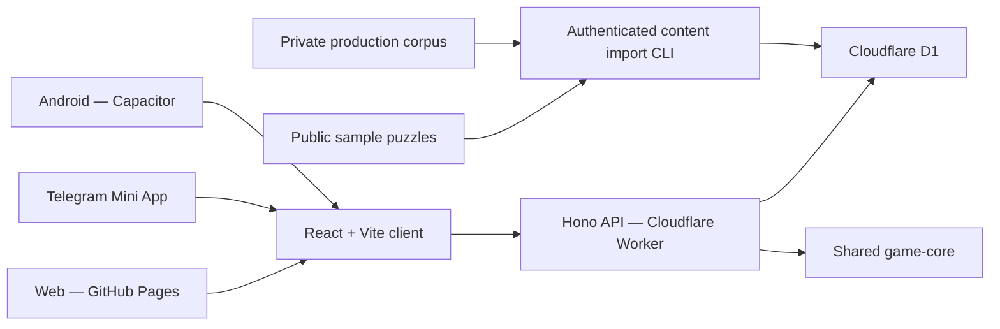

# A MOVE AGO — архитектура MVP

- Статус: утверждено для планирования
- Дата: 2026-08-03
- Репозиторий: `agent-axiom/a-move-ago`
- Владельцы продукта: Agent Axiom

## 1. Резюме решения

A MOVE AGO — ежедневная ретро-шахматная игра. Игрок видит позицию **после** неизвестного хода и должен восстановить, что произошло ход назад: вернуть перемещённую фигуру, при необходимости восстановить взятую фигуру и объяснить получившуюся позицию.

MVP использует один TypeScript-клиент для трёх оболочек:

1. обычный web на GitHub Pages;
2. Telegram Mini App, открывающий тот же web build;
3. Android-приложение, упаковывающее тот же build через Capacitor.

Все клиенты обращаются к единому Hono API на Cloudflare Workers. Production-данные хранятся в Cloudflare D1. Играть можно без регистрации; единственный необязательный аккаунт — Telegram.

Код публикуется под AGPL-3.0. Небольшой набор демонстрационных задач публикуется отдельно под CC BY 4.0. Production-корпус задач и бренд не открываются.

## 2. Цели MVP

- Дать понятный за несколько секунд игровой цикл: «посмотри на последствия и отмотай ход».
- Позволить пройти ежедневную задачу без регистрации.
- Синхронизировать прогресс между платформами после добровольного входа через Telegram.
- Переиспользовать один интерфейс и одну доменную модель на Web, Telegram и Android.
- Не раскрывать ответы и production-корпус в публичном frontend bundle или GitHub.
- Сделать добавление и предварительную проверку новых задач воспроизводимым процессом.
- Получить проверяемый baseline: тесты доменной логики, API, платформенных адаптеров и сборок.

## 3. Не входит в MVP

- Универсальный ретро-шахматный solver, доказывающий единственность любой позиции во время запроса.
- Полноценная игра против человека или движка.
- Email/password, Google, Apple или другие способы входа.
- Социальная сеть, чат, клубы и турнирный matchmaking.
- Платежи, подписки и Telegram Stars.
- Полноценный офлайн-режим с локальной проверкой правильного ответа.
- Админская web-панель для публикации задач.
- Автоматическая публикация в Google Play.

## 4. Продуктовый цикл

### 4.1. Первый запуск

1. Клиент сразу создаёт техническую гостевую сессию.
2. Игрок видит текущую ежедневную задачу без signup wall.
3. Backend возвращает публичное условие, но не решения.
4. Профиль Telegram предлагается как способ сохранить прогресс, а не как условие игры.

### 4.2. Решение позиции

1. Игрок выбирает фигуру, которая, по его мнению, ходила последней.
2. Возвращает её на предыдущее поле.
3. Если последний ход был взятием, выбирает и восстанавливает взятую фигуру.
4. Для специальных случаев интерфейс поддерживает рокировку, en passant и обратное превращение.
5. Клиент проверяет форму действия и допустимость взаимодействия, но не знает правильного ответа.
6. Backend сравнивает реконструкцию с подготовленными допустимыми решениями.
7. Ошибка возвращает объяснимое противоречие или доступную подсказку.
8. Успех запускает обратную анимацию, затем воспроизводит настоящий ход вперёд и обновляет статистику.

Ежедневное «дело» может содержать одну или несколько упорядоченных позиций. Стартовый контент может использовать одну позицию в день, не меняя модель данных.

### 4.3. Гостевой режим

- Гость может решать задачи, брать подсказки и вести streak.
- Backend хранит попытки под непрозрачной гостевой сессией; это не пользовательский аккаунт.
- Сессия привязана к локальному token и не синхронизируется между устройствами.
- При очистке данных браузера или приложения гостевой прогресс может быть потерян.
- При последующем входе через Telegram сервер переносит подтверждённые гостевые попытки в профиль.

### 4.4. Telegram-профиль

- Аккаунт создаётся только после явного действия «Сохранить прогресс через Telegram».
- В Mini App наличие `initData` само по себе не создаёт профиль и не отправляется backend'у до согласия игрока.
- Запрашиваются только идентификатор и базовый профиль; телефон и право писать пользователю не запрашиваются.
- Telegram-профиль синхронизирует прогресс между всеми тремя клиентами.

## 5. Архитектура системы



### 5.1. Monorepo

```text
a-move-ago/
├── apps/
│   ├── client/                  # Web, Telegram Mini App, Capacitor UI
│   │   └── android/             # Native Capacitor Android project
│   └── api/                     # Hono Cloudflare Worker
├── packages/
│   ├── game-core/               # Pure retro-chess domain logic
│   ├── api-contract/            # Zod DTOs, errors and typed API client
│   └── platform/                # Web, Telegram and Android adapters
├── content/
│   └── samples/                 # Public non-production examples
├── tools/                       # Puzzle validation and import CLI
├── docs/
├── .github/workflows/
└── package.json                 # npm workspaces
```

### 5.2. Технологический baseline

- TypeScript во всех web/backend/shared пакетах.
- React + Vite для интерфейса.
- Capacitor 8 для Android-оболочки.
- Hono на Cloudflare Workers для HTTP API.
- Cloudflare D1 для production и локальной разработки.
- Zod для runtime-валидации API и контента.
- npm workspaces для monorepo без дополнительного package manager.
- Vitest, Cloudflare Workers test pool и Playwright для проверок.

## 6. Клиент и платформенные границы

### 6.1. App shell

`apps/client` содержит единый интерфейс доски, ежедневного дела, подсказок, результата, streak и профиля. UI не импортирует Telegram или Capacitor API напрямую: все host-возможности доступны через пакет `platform`.

### 6.2. Platform adapter

Общий контракт предоставляет:

- определение `web | telegram | android`;
- lifecycle `ready()`;
- back navigation;
- safe area и стабильную высоту viewport;
- haptic feedback;
- открытие внешнего браузера;
- получение Telegram Mini App proof по явному действию пользователя;
- локальное безопасное хранилище session token;
- обработку Android App Link.

Telegram `window.Telegram.WebApp` и Android `Capacitor` считаются host hints, но не доказательством личности. Личность признаётся только после серверной проверки Telegram proof.

### 6.3. Навигация на GitHub Pages

Production entry point:

```text
https://agent-axiom.github.io/a-move-ago/
```

Vite build использует `base: /a-move-ago/`. Поскольку GitHub Pages не выполняет SPA rewrite, приложение не использует вложенные history paths. Экранная навигация живёт в memory state, а внешне адресуемые параметры передаются query string, например:

```text
?case=2026-08-03
```

`HashRouter` не используется: Telegram также передаёт launch parameters во fragment.

### 6.4. Telegram host integration

- Официальный Telegram Web App script загружается до application bundle.
- После готовности essential UI вызывается `ready()`.
- Используются Telegram safe-area variables и `viewportStableHeight`.
- Telegram BackButton синхронизируется с memory navigation.
- `initDataUnsafe` разрешено применять только для непроверенных UI hints.
- Для входа на backend передаётся неизменённый `initData`.

### 6.5. Android

- App ID: `com.agentaxiom.amoveago`.
- Минимальная Android API: 24, согласно Capacitor 8 baseline.
- Web assets синхронизируются в native project при сборке.
- Небольшие значения, включая session token, хранятся через Capacitor Preferences, а не `localStorage`.
- OIDC открывается в системном браузере через Capacitor Browser.
- Production callback возвращается через verified HTTPS App Link на API host.
- Worker обслуживает `/.well-known/assetlinks.json` для Android package и signing fingerprint.
- Debug-сборка может использовать отдельный custom scheme как development fallback; одноразовый handoff не позволяет использовать перехваченный URL повторно.

## 7. Авторизация и сессии

### 7.1. Общий принцип

Любой клиент начинает с гостевой сессии. Telegram — единственный identity provider и всегда необязателен.

Session token:

- случайный, непрозрачный и не содержит claims;
- передаётся как Bearer token;
- в D1 хранится только криптографический hash с server-side pepper;
- может быть отозван;
- имеет ограниченный и конфигурируемый срок действия;
- никогда не попадает в логи.

### 7.2. Вход внутри Mini App

1. Игрок нажимает кнопку входа.
2. Клиент отправляет текущую гостевую сессию и raw `Telegram.WebApp.initData`.
3. Worker проверяет HMAC-SHA-256 в constant time, `auth_date` и обязательные поля.
4. Максимальный возраст proof конфигурируется; baseline — 60 минут, чтобы не ломать вход после прохождения задачи.
5. Worker использует проверенный numeric Telegram user ID, создаёт или находит профиль.
6. Подтверждённые попытки гостевой сессии привязываются к профилю.
7. Старый token отзывается, клиент получает новую авторизованную сессию.

Невалидный или просроченный Telegram proof возвращает `401`; приложение не выполняет тихий downgrade во время операции входа.

### 7.3. Вход из Web и Android

Используется Telegram OpenID Connect Authorization Code Flow с PKCE S256:

1. Клиент вызывает start endpoint с каналом `web` или `android` и текущей гостевой сессией.
2. Backend создаёт `state`, `nonce`, PKCE verifier/challenge и краткоживущую запись `auth_flow`.
3. Клиент выполняет top-level redirect в web или открывает системный браузер в Android.
4. Telegram возвращает `code` на один заранее зарегистрированный HTTPS callback Worker'а.
5. Worker меняет code на tokens с использованием client secret.
6. Worker проверяет JWKS signature, `iss`, `aud`, `exp`, `nonce` и привязывает numeric Telegram ID из scope `profile`.
7. Worker создаёт одноразовый handoff code со сроком около 60 секунд.
8. Web возвращается на корень Pages с `?handoff=...`; Android — на verified App Link.
9. Клиент погашает handoff code и получает обычную app session.

`state` содержит серверную ссылку на разрешённый канал, а не произвольный return URL. Это исключает open redirect. Client secret никогда не попадает в GitHub Pages bundle или APK.

OIDC scopes MVP:

```text
openid profile
```

Scopes `phone` и `telegram:bot_access` не используются.

### 7.4. BotFather configuration

Перед production login владелец создаёт bot и регистрирует в BotFather:

- Main Mini App URL GitHub Pages;
- точный HTTPS OIDC callback Worker'а;
- при необходимости web origin для Telegram Login JS library;
- Android package/signing data для будущего native SDK.

Bot token, OIDC client secret и session pepper хранятся только в Cloudflare/GitHub secrets.

## 8. HTTP API v1

### 8.1. System

```text
GET  /v1/healthz
```

### 8.2. Sessions and Telegram auth

```text
POST /v1/sessions/guest
POST /v1/auth/telegram/mini-app
POST /v1/auth/telegram/oidc/start
GET  /v1/auth/telegram/oidc/callback
POST /v1/auth/session/exchange
POST /v1/auth/logout
GET  /v1/me
```

### 8.3. Game

```text
GET  /v1/daily
POST /v1/attempts
POST /v1/attempts/:id/hints
GET  /v1/me/stats
```

`GET /v1/daily` возвращает только публичные поля дела и задач. Решения, private constraints и полные объяснения до завершения не возвращаются.

`POST /v1/attempts` требует client-generated attempt UUID. Повтор с тем же UUID в той же сессии возвращает прежний результат и не увеличивает счётчики.

### 8.4. Contract and errors

`api-contract` содержит Zod-схемы request/response и типизированный fetch client. Все ошибки используют envelope:

```json
{
  "error": {
    "code": "ATTEMPT_CONTRADICTION",
    "message": "This reconstruction leaves the previous king in check.",
    "requestId": "01J..."
  }
}
```

Публичное сообщение не содержит stack trace, SQL или secret values.

## 9. Модель данных D1

### 9.1. Таблицы

`players`

- внутренний UUID;
- verified Telegram numeric user ID, unique;
- OIDC issuer/subject/audience при OIDC-входе;
- display name, username и avatar URL как необязательный профиль;
- timestamps.

`sessions`

- UUID;
- nullable `player_id` для гостя;
- token hash;
- kind `guest | telegram`;
- expiry, revoked и last-seen timestamps.

`auth_flows`

- state hash;
- guest session ID;
- channel `web | android`;
- nonce и PKCE verifier в защищённой серверной записи;
- expiry и consumed timestamp;
- одноразовый handoff hash после callback.

`puzzles`

- ID, версия и статус;
- публичный FEN после неизвестного хода;
- сторона, которая должна отмотать ход;
- публичное условие и display metadata;
- происхождение, автор и license metadata.

`puzzle_solutions`

- допустимые предыдущие ходы;
- восстановленная фигура или специальный случай;
- private retro constraints;
- contradiction explanations и reveal payload.

`daily_cases`

- глобальная UTC-дата, slug, title и publication status.

`daily_case_puzzles`

- case ID, puzzle ID, порядок и act metadata.

`attempts`

- attempt UUID и session ID;
- nullable player ID;
- case/puzzle IDs;
- нормализованный ответ;
- correct, hints used и timestamps;
- unique `(session_id, attempt_uuid)` для идемпотентности.

`hint_events`

- attempt, hint level, timestamp.

Streak и основные показатели вычисляются из подтверждённых attempts; отдельная mutable stats table в MVP не нужна.

### 9.2. Daily boundary

Текущая задача определяется Worker'ом по UTC, а не локальными часами клиента. Scheduled Worker может заранее публиковать или прогревать следующее дело, но `GET /daily` всегда умеет найти опубликованную запись по дате, поэтому сбой cron не блокирует игру.

## 10. Доменная модель задач

FEN недостаточен для доказательства истории позиции. Формат задачи дополнительно хранит:

- сторону, сделавшую неизвестный ход;
- допустимые поля `from` и `to`;
- восстановленную взятую фигуру и поле;
- castling, en-passant и promotion/unpromotion metadata;
- дополнительные ограничения истории;
- одно или несколько эквивалентных допустимых решений;
- последовательность подсказок;
- объяснения типичных противоречий;
- forward reveal animation.

`game-core` остаётся чистым TypeScript-пакетом без UI, Worker или storage imports. Он:

- нормализует ответ игрока;
- моделирует обратное перемещение и восстановление фигуры;
- проверяет базовую шахматную легальность получившейся позиции;
- классифицирует известные противоречия;
- сравнивает нормализованный ответ с curated accepted solutions.

Полная уникальность задачи устанавливается до публикации: offline validator плюс человеческая редактура. Runtime не пытается решить произвольную ретро-позицию с нуля.

## 11. Контентный pipeline

- Публичный репозиторий содержит только несколько лицензированных sample puzzles.
- Production-корпус хранится вне GitHub.
- Общая Zod-схема валидирует и samples, и private source files.
- CLI выполняет schema validation, доменные проверки, повторяемость решения и формирует import artifact.
- Production import требует Cloudflare credentials и не доступен из публичного приложения.
- Админского mutation endpoint общего назначения в MVP нет.
- Каждая задача обязана содержать provenance и license metadata.

## 12. Безопасность и приватность

- Raw Telegram `initData`, OIDC tokens, bot token, client secret и app session tokens никогда не логируются.
- Telegram signatures и hashes сравниваются constant-time операциями.
- Все SQL-запросы параметризованы.
- CORS использует точный allowlist для GitHub Pages, production Android/Web origins и локальной разработки; CORS не считается механизмом авторизации.
- Все state-changing endpoints требуют app session и origin/channel checks, где применимо.
- OIDC state и handoff single-use и имеют короткий TTL.
- `state` не содержит произвольных redirect URLs.
- Worker выдаёт request ID и структурированные logs без персональных payloads.
- Rate limiting применяется к созданию сессий, auth start, attempts и hints.
- Frontend использует строгий meta CSP, насколько это позволяет GitHub Pages, и минимизирует third-party scripts.
- Профиль хранит только данные Telegram, нужные для отображения и связывания прогресса.
- Удаление профиля и очистка связанных персональных данных проектируются до публичного запуска, даже если UI удаления появится после первого scaffold.

## 13. Сетевые ошибки и устойчивость

- Клиент различает offline, auth, server, rate-limit и content errors.
- GET-запросы можно повторять с exponential backoff и jitter.
- POST attempt повторяется только с тем же idempotency UUID.
- При потере сети незавершённое действие остаётся на экране и может быть отправлено повторно.
- Неполученный ответ не считается ошибочной попыткой.
- Если auth proof невалиден, текущий guest progress не удаляется.
- Если daily content отсутствует, UI показывает recoverable empty state с request ID.

## 14. CI/CD

### 14.1. `ci.yml`

На pull request и push:

- reproducible `npm ci`;
- formatting/lint checks;
- TypeScript typecheck;
- unit tests;
- Worker integration tests с локальной D1;
- puzzle sample validation;
- production builds клиента и Worker'а.

### 14.2. `pages.yml`

После успешных проверок на `main`:

- собирает client с base `/a-move-ago/`;
- загружает `dist` как Pages artifact;
- публикует через официальный GitHub Pages Actions flow;
- использует только `pages: write` и `id-token: write` permissions.

### 14.3. `api.yml`

- Запускается вручную через `workflow_dispatch` в MVP.
- Проверяет тесты и собирает Worker до deploy.
- Применяет D1 migrations явным шагом.
- Требует scoped Cloudflare API token, account ID и D1 database ID.
- Production deploy не выполняется, пока владелец не добавит secrets.

### 14.4. `android.yml`

- Устанавливает Java 21 и Android SDK в GitHub Actions.
- Синхронизирует Capacitor assets.
- Собирает debug APK/AAB как artifact.
- Signed release AAB и Google Play upload добавляются после выдачи keystore и Play credentials.

Локальная среда в момент проектирования не содержит Java/Android SDK, поэтому окончательная Android compile verification выполняется в CI.

## 15. Тестовая стратегия

### 15.1. Domain

- Нормализация обычного reverse move.
- Восстановление взятой фигуры.
- Рокировка, en passant и unpromotion.
- Недопустимый шах в предыдущей позиции.
- Несколько эквивалентных accepted solutions.
- Property-based invariants там, где их можно выразить без полного solver'а.

### 15.2. API

- Guest session lifecycle и token hashing.
- Mini App HMAC, TTL и malformed input.
- OIDC state, PKCE transaction, claims verification и replay rejection.
- Guest-to-Telegram progress merge.
- Daily UTC selection.
- Attempt idempotency и отсутствие solution leakage.
- Hint progression, rate limit и error envelope.
- D1 migrations с чистой базой.

### 15.3. Client

- Web, Telegram и Android adapters.
- GitHub Pages base path и query entry.
- Telegram BackButton и safe-area reactions.
- Guest-first onboarding и явное Telegram consent.
- Offline retry без двойной попытки.
- Reveal animation state machine.

### 15.4. End-to-end and builds

- Playwright smoke test production-like Pages build.
- Успешное прохождение одной sample puzzle.
- Ошибка и подсказка без раскрытия private solution в initial payload.
- Android debug build в GitHub Actions.

## 16. Лицензирование и граница открытости

- Исходный код: AGPL-3.0.
- `content/samples`: CC BY 4.0 с отдельным notice об авторах.
- Production puzzle corpus: private, All Rights Reserved или индивидуальные лицензии правообладателей; в GitHub не публикуется.
- Название A MOVE AGO, логотип и визуальная айдентика не предоставляются по software license.
- CONTRIBUTING фиксирует, что вклад в код принимается под AGPL-3.0, а контент — только с явной provenance/license записью.

Такая модель делает инфраструктуру проверяемой и пригодной для сообщества, но сохраняет продуктовый moat в редактуре, корпусе задач и бренде.

## 17. Configuration and secrets

Репозиторий содержит только примеры переменных. Production требует следующую конфигурацию:

- `TELEGRAM_BOT_TOKEN`;
- `TELEGRAM_OIDC_CLIENT_ID`;
- `TELEGRAM_OIDC_CLIENT_SECRET`;
- `SESSION_PEPPER`;
- `CLOUDFLARE_API_TOKEN`;
- `CLOUDFLARE_ACCOUNT_ID`;
- `D1_DATABASE_ID`;
- Android signing secrets только для release workflow.

Значения bot username, Worker hostname и production signing fingerprint являются deployment configuration, а не блокерами scaffold.

## 18. MVP acceptance criteria

MVP считается архитектурно завершённым, когда:

1. один sample case можно открыть и пройти в обычном браузере;
2. тот же build корректно адаптируется внутри Telegram WebView;
3. тот же build собирается в Android debug application;
4. гость может начать игру без входа;
5. Mini App login валидирует raw initData только backend'ом;
6. Web/Android OIDC использует server callback, PKCE и одноразовый handoff;
7. гостевой прогресс переносится в Telegram-профиль;
8. initial daily response не содержит accepted solution;
9. повтор attempt UUID идемпотентен;
10. D1 schema разворачивается с нуля миграциями;
11. CI, Pages build, Worker tests и Android build проходят;
12. public repository не содержит production puzzles или secrets.

## 19. Отложенные решения

Следующие решения не меняют архитектуру и принимаются перед соответствующим production deploy:

- окончательный bot username;
- Cloudflare account и Worker hostname;
- визуальная айдентика и production assets;
- Android release keystore и Play Console application;
- точный объём стартового production-корпуса;
- политика streak freeze, leaderboard и social sharing после проверки базового retention.

## 20. Первичные технические источники

- [Telegram Mini Apps](https://core.telegram.org/bots/webapps)
- [Telegram Mini App data validation](https://core.telegram.org/bots/webapps#validating-data-received-via-the-mini-app)
- [Log In With Telegram и OIDC](https://core.telegram.org/bots/telegram-login)
- [GitHub Pages custom workflows](https://docs.github.com/en/pages/getting-started-with-github-pages/using-custom-workflows-with-github-pages)
- [Vite deployment to GitHub Pages](https://vite.dev/guide/static-deploy.html#github-pages)
- [Capacitor Android](https://capacitorjs.com/docs/android)
- [Capacitor deep links](https://capacitorjs.com/docs/guides/deep-links)
- [Android App Links](https://developer.android.com/training/app-links/about)
- [Cloudflare D1 local development](https://developers.cloudflare.com/d1/best-practices/local-development/)
- [Cloudflare D1 migrations](https://developers.cloudflare.com/d1/reference/migrations/)
- [Hono on Cloudflare Workers](https://hono.dev/docs/getting-started/cloudflare-workers)
